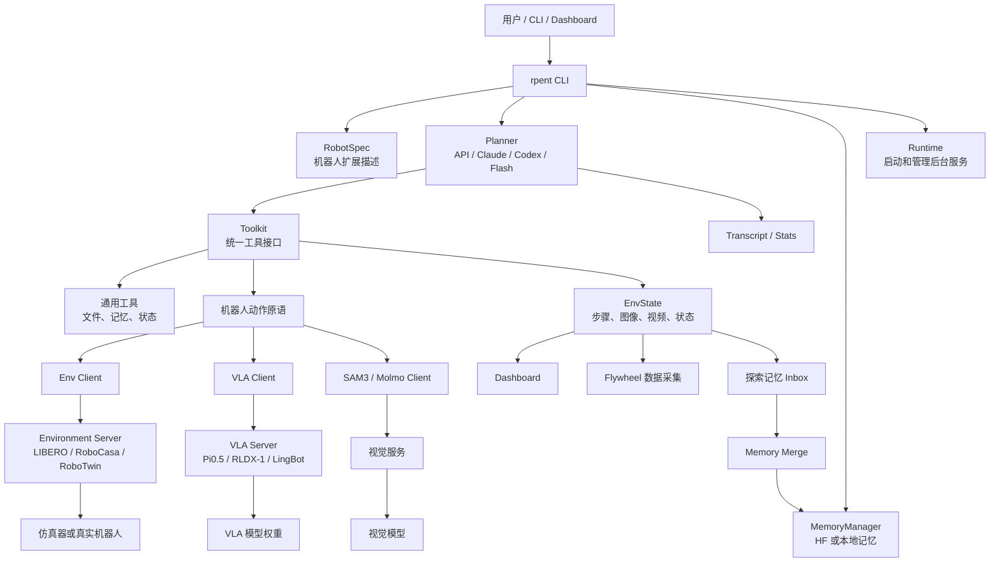
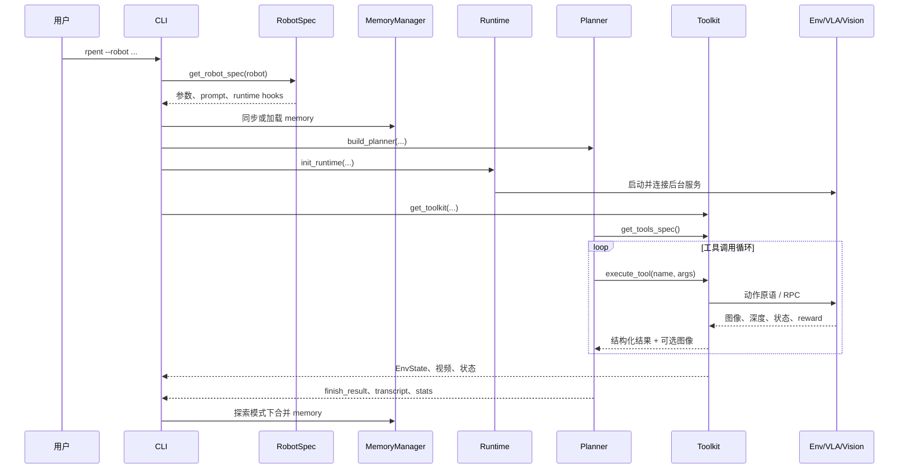
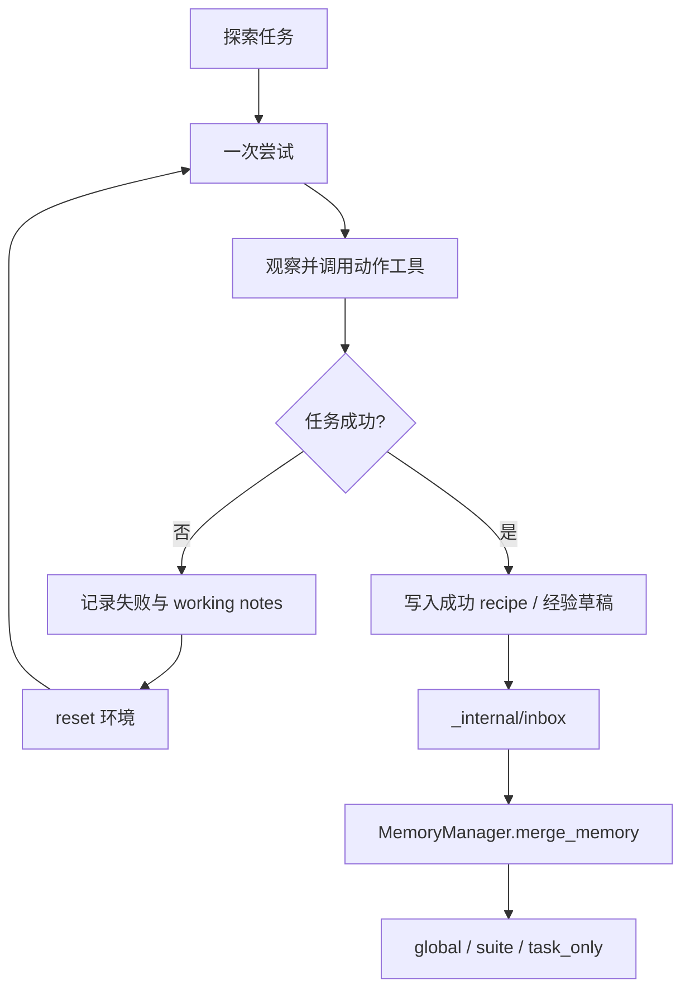

# RPent 项目结构与数据流程

## 1. 项目定位

RPent（Recursive Physical Agent）是一个面向物理世界的具身智能体基础设施。它不是单一的机器人模型，也不是传统的模型训练框架，而是把大模型规划器、VLA、视觉服务、仿真器/真实机器人、动作原语、记忆系统、评测和数据采集组织成一个可组合的运行时。

可以用一句话理解：

> Planner 决定“做什么”，动作原语决定“怎么做”，环境或机器人负责“执行”，Memory 负责“记住以前学到的经验”。

## 2. 顶层架构



核心分层是：

```text
rpent/       通用框架
robots/      具体机器人和环境
RPC          跨进程服务化
memory/      经验积累
flywheel/    数据飞轮
dashboard/   运行监控
```

## 3. 目录结构

```text
RPent/
├── rpent/                 # 框架核心
│   ├── cli/               # 命令行入口
│   ├── planner/           # API / Claude Code / Codex / Flash 规划器
│   ├── robots/            # 框架级机器人抽象和公共组件
│   ├── tools/             # Toolkit、工具注册与调度
│   ├── session/           # EnvState、StepRecord、运行产物
│   ├── memory/            # 记忆读取、同步、验证、合并
│   ├── dashboard/         # 本地 Web Dashboard
│   ├── evaluation/        # 评测结果收尾
│   ├── flywheel/          # 轨迹数据采集与导出
│   ├── prompt/            # 通用提示词工具
│   └── utils/             # RPC、配置、进程、序列化等
├── robots/                # 具体机器人 / 仿真后端
│   ├── libero/
│   ├── robocasa/
│   ├── robotwin/
│   ├── franka/
│   └── dual_franka/
├── tests/                 # 单元、集成、端到端测试
├── docs/                  # 中英文文档
├── pyproject.toml         # 依赖、安装项、命令行入口
└── README*.md             # 项目说明
```

`rpent/robots/` 放框架抽象，例如 `RobotSpec`、统一 Runtime 和公共客户端；顶层 `robots/<name>/` 放具体环境的实现。这个边界让 Planner 与 LIBERO、RoboCasa、RoboTwin 或真实 Franka 解耦。

## 4. 主要模块

### 4.1 CLI：一次运行的总调度器

入口是 `rpent/cli/main.py`，安装后对应 `rpent` 命令。它负责：

1. 解析通用参数和机器人专属参数；
2. 通过 `RobotSpec` 找到具体后端；
3. 同步或加载 Memory；
4. 构造 Planner 和 prompt；
5. 启动环境、VLA、视觉等后台服务；
6. 构造 Toolkit 并进入 Planner 循环；
7. 写出 transcript、状态、视频、评测结果；
8. 探索模式下合并新的 Memory。

### 4.2 Planner：高层决策循环

`rpent/planner/` 提供四类 Planner：

| Planner | 作用 |
| --- | --- |
| `api` | 用 Pydantic AI 直接调用模型 API |
| `claude_code` | 使用 Claude Agent SDK |
| `codex` | 使用 OpenAI Codex SDK |
| `flash` | 重放 Memory 中保存的成功计划，不重新做完整 LLM 规划 |

所有 Planner 都通过同一个协议调用：

```python
planner.solve(
    system_prompt=...,
    user_message=...,
    toolkit=...,
    max_turns=...,
)
```

Planner 不直接调用机器人 API，只能看到 prompt、工具 schema 和工具返回结果。

### 4.3 Toolkit：Planner 与机器人之间的适配层

`rpent/tools/toolkit.py` 中的 `Toolkit` 负责：

- 注册工具和输入 schema；
- 向 Planner 暴露 `get_tools_spec()`；
- 通过 `execute_tool(name, input_dict)` 调度工具；
- 捕获工具异常和取消信号；
- 对非只读工具自动记录执行后的环境状态；
- 向 Dashboard 发布步骤事件。

因此 Planner 只需要执行：

```python
tool_specs = toolkit.get_tools_spec()
result = toolkit.execute_tool(tool_name, arguments)
```

机器人 Toolkit 再把这些调用转换成移动、抓取、释放、旋转、分割等具体动作原语。

### 4.4 RobotSpec 与具体机器人后端

`rpent/robots/robot_spec.py` 定义机器人扩展契约，包含：

- 机器人名称；
- prompt bundle；
- CLI 参数注册和配置解析；
- Runtime 初始化；
- 是否支持探索；
- 是否支持 Flash Mode；
- 评测收尾函数。

具体后端通常包含：

```text
robot_spec.py       机器人注册、参数和运行配置
toolkit.py          工具集合
tools.py            动作原语和状态读取
env_client.py       环境 RPC 客户端
env_server.py       环境 RPC 服务端
vla_client.py       VLA 客户端
vla_server.py       VLA 服务端
prompt_bundle.py    机器人专属 prompt
```

## 5. 一次评测运行的数据流程

例如：

```bash
rpent --robot libero --suite libero_object_swap --task 2 --seed 0 \
  --planner claude_code --model claude-opus-4-8
```

启动和执行过程如下：



一次工具调用的内部路径通常是：

```text
LLM
  ↓
Toolkit.execute_tool()
  ↓
机器人动作原语
  ↓
VLA Client / Vision Client / Env Client
  ↓ RPC
VLA Server / Vision Server / Environment Server
  ↓
仿真器或真实机器人
  ↓
新图像、深度、机器人状态
  ↓
EnvState + Planner
```

VLA 通常不是 Planner 直接调用的，而是被某个动作原语调用：LLM 选择技能，VLA 生成动作 chunk，环境执行动作并返回反馈。

## 6. RPC 服务化

RPC 代码位于 `rpent/utils/rpc/`，支持 HTTP 和 socket 两种传输。典型环境接口包括：

```text
env.reset
env.step
env.chunk_step
env.render_camera
env.get_camera_meta
env.get_task_language
```

VLA 接口通常是：

```text
vla.predict
```

numpy 数组通过带有 dtype、shape 和 base64 数据的结构传输。服务化的目的包括隔离 Torch/Transformers 依赖、隔离 GPU 模型和仿真器、复用客户端协议，以及支持本地或远程部署。

## 7. EnvState 与运行产物

`rpent/session/base.py` 中的 `EnvState` 是一次运行的状态账本。每个动作步骤对应一个 `StepRecord`，通常包含：

- `step_idx`：步骤编号；
- `state`：环境状态；
- `command`：调用了哪个工具及其参数；
- `result`：工具结果；
- `terminated` / `truncated`：环境结束标志；
- `elapsed_s`：动作耗时；
- `artifacts`：关联的图像、数组、视频或 JSON 文件。

常见运行产物包括：

```text
output_dir/
├── states.json
├── transcript_<recipe_tag>.json
├── episode.mp4
├── action_*.mp4
├── *.png / *.npy / *.json
└── *_recipe.jsonl
```

`ToolResult` 会把工具返回值拆成文本 JSON 和可选的图像 content block，供多模态 Planner 使用。

## 8. Memory 与递归探索

`rpent/memory/manager.py` 管理跨任务经验。Memory 可以从 Hugging Face 数据集同步，也可以使用本地目录。

典型布局是：

```text
memory/<robot>/
├── global/       # 跨任务经验：primitive、perception、strategy、failure、infra
├── suite/        # 任务套件或任务族经验
├── task_only/    # 具体任务的审计和成功 recipe
├── _internal/
│   ├── inbox/    # 探索期间写入的草稿
│   ├── conflicts/
│   └── merged/
└── MEMORY.md     # 自动生成的索引
```

### Evaluation

普通评测通常只读 Memory：

```text
读取已有 memory → Planner 执行任务 → 保存结果
```

### Exploration

`--explore` 会开启递归探索：



探索可以跨多个 planner session；成功后，草稿和任务级 recipe 会在条件满足时合并到 Memory corpus。

### Flash

Flash Mode 读取已经保存的成功计划，对 waypoint 重新做视觉定位后直接执行，适合快速评测和计划重放，不等同于在线 LLM 规划。

## 9. Flywheel 与 Dashboard

`rpent/flywheel/` 将 RGB、深度、动作和状态整理成 Episode，后续可导出用于训练或分析，形成：

```text
运行机器人 → 记录轨迹 → 导出 Episode → 训练 / 分析 → 改善策略
```

`rpent/dashboard/` 提供本地 Web 监控界面，可以查看任务、推理状态、后台服务、相机画面、动作时间线和任务结果。Dashboard 是观察与交互层，不替代 Planner 或 Toolkit 的核心控制逻辑。

## 10. 推荐阅读顺序

1. `README.zh-CN.md`：先了解安装、支持的后端和运行方式；
2. `rpent/cli/main.py`：看一次运行如何被串起来；
3. `rpent/planner/base.py`：理解 Planner 协议；
4. `rpent/tools/toolkit.py`：理解工具注册和执行；
5. `rpent/robots/robot_spec.py`：理解机器人扩展点；
6. `rpent/session/base.py`：理解步骤和文件产物；
7. `rpent/memory/manager.py`：理解记忆合并；
8. `robots/libero/`：选择一个具体后端深入；
9. `rpent/utils/rpc/`：最后看进程间通信和部署细节。

## 11. 总结

RPent 的核心闭环是：

```text
任务
 → Planner 推理
 → Toolkit 工具
 → 动作原语
 → VLA / 视觉 / 环境服务
 → 新观测
 → EnvState 记录
 → transcript / episode / evaluation / memory
 → 下一次更好的规划
```

因此，RPent 同时具备以下几种属性：

```text
Agent Runtime
Robot Control Framework
Evaluation Harness
Data Collection Pipeline
Memory Evolution System
```
